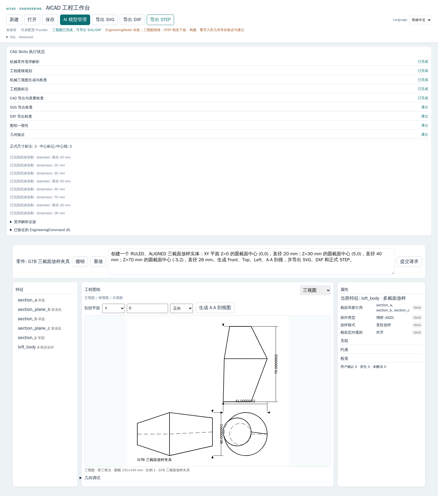
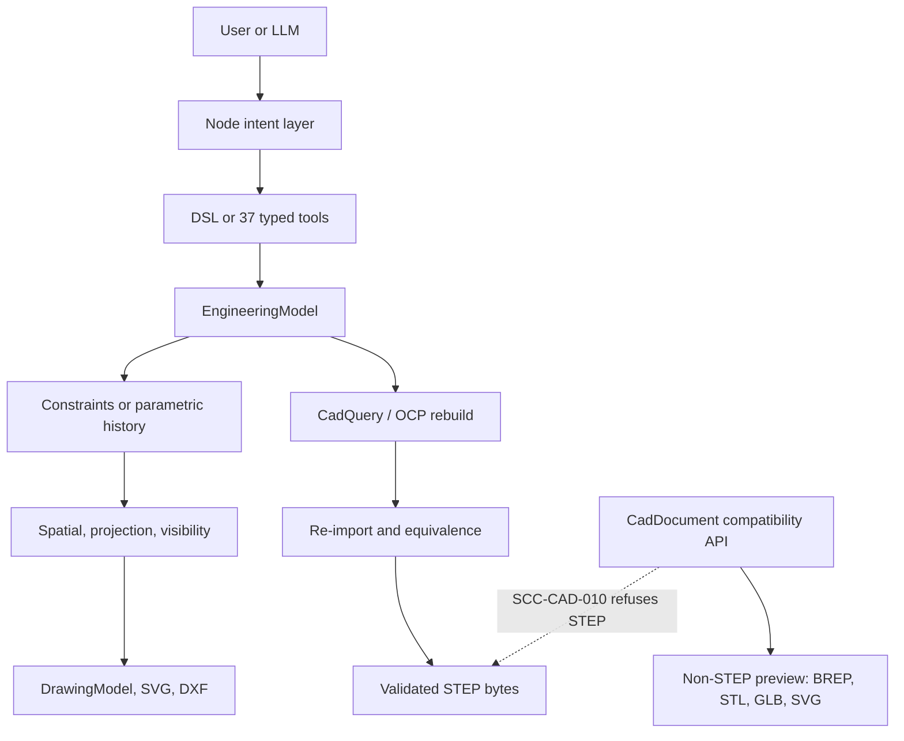

[English](README.md) | [简体中文](README.zh-CN.md)


# AICAD

**Semantic Constraint Compiler**

From engineering intent to verifiable CAD.

  

AICAD is an alpha CAD compiler for parts that can be stated as an editable engineering model. Natural language is an optional way to propose that model. It is not the geometry kernel. A language model never writes the solid, the drawing, or the STEP file. Those come from a deterministic pipeline: a typed model, a constraint or feature-history rebuild, orthographic drawings, and a STEP export that is re-imported and checked before the bytes are returned.

This is not a general commercial CAD replacement. The supported geometry is bounded, and several operations fail closed on purpose. Version 0.4.0-alpha.1 is a public-prep snapshot. Claims below are about the source in this tree. A row is "verified in this snapshot" only when [docs/release/TEST_REPORT.md](docs/release/TEST_REPORT.md) says that exact command passed here.

## Why AICAD?

Text-to-CAD tools often ask a model to emit a script or a mesh and then hope the result is the part. That breaks down when a later edit must hit the same hole, when a drawing must match the solid, or when a STEP file must be the file that was actually checked.

AICAD keeps those jobs in an engineering core that does not know which model vendor you use.

| Idea | What the code does |
| --- | --- |
| Editable Engineering Model | `EngineeringModel` in `crates/scc-engineering` is the design state. A project file stores metadata plus that model, not a disposable mesh. |
| Deterministic geometry pipeline | v1 parts solve through `scc-geometry` into spatial, projection, visibility, and drawing crates. v2 histories rebuild in order through CadQuery/OCP. |
| Structured constraints | The solver accepts a closed set: Fixed, Datum, CenterOf, point Distance checks, Align, Parallel, Perpendicular, ArrayRelation, InstanceOf. Anything else fails closed. |
| Validated manufacturing export | Formal STEP is built, re-imported, and compared. The bytes you receive are the bytes that passed. |
| Fail-closed unsupported operations | Missing data and out-of-domain geometry return stable `SCC-*` errors. The pipeline does not substitute a lookalike solid. |
| Model-independent engineering core | Provider code lives in the Node service (`ADR-020`). The Rust crates do not import an LLM SDK. |

## See it in action

The reproducible part in this snapshot is the built-in mounting plate: a 120 mm by 80 mm rectangle, 10 mm thick, with four corner holes. The Workbench button **载入内置安装板** loads the same DSL as [examples/mounting-plate.dsl](examples/mounting-plate.dsl). No AI provider is required.

```text
Engineering intent or DSL
  -> EngineeringModel
  -> geometry
  -> Front / Top / Left drawing
  -> validated STEP
```

Build the compiler, then run the two commands that do not need CadQuery:

```bash
cargo build --locked --release -p scc-cli
./target/release/scc engineering dsl examples/mounting-plate.dsl > /tmp/mounting-plate.model.json
./target/release/scc engineering drawing-three-view /tmp/mounting-plate.model.json
```

Formal STEP uses the same model and the CadQuery path:

```bash
./target/release/scc engineering export-step /tmp/mounting-plate.model.json > /tmp/mounting-plate.step
```

`export-step` fails closed when `SCC_CAD_PYTHON` cannot import CadQuery. The Docker image sets that variable. Do not send this model to `POST /api/cad/build` and expect a STEP file. That route returns `SCC-CAD-010`.

The picture below is a real Engineering Workbench frame from the G7B loft acceptance on an ancestor of baseline `0568fac`. It was not recaptured for 0.4.0-alpha.1, and it is not the mounting-plate demo. It shows a three-section loft fixture that the bounded Loft implementation can represent.



## Architecture



Two authorities stay separate.

- **EngineeringModel** is the formal part. v1 is a base profile plus holes, patterns, and slots. v2 is an ordered parametric history, and the project schema becomes 2 when those features are present. v2 does not go through the legacy proposal solver. Formal STEP for v2 enters as `FormalManufacturingInput::ProjectV2` and still ends in the same re-import check.
- **CadDocument** is a compatibility editor for previews and non-STEP artifacts. `POST /api/cad/build` runs `python -m aicad_cad.worker` without a shell and rejects a STEP artifact.

A compatible CAD endpoint cannot bypass STEP validation.

## Features

Status values mean:

- **Verified in this snapshot** — a command recorded in the test report passed on this tree.
- **Limited / Experimental** — the source implements a bounded behavior. Either the domain is intentionally narrow, or this snapshot has not re-run the proving test.
- **Not yet supported** — the operation is rejected or is absent.

A bounded case can pass and the capability still stay **Limited / Experimental**, because the domain is intentionally narrow. [docs/release/TEST_REPORT.md](docs/release/TEST_REPORT.md) is the evidence for this snapshot. A missing row there is not a pass. The gated G7C Sweep and Loft cases passed on this tree. They stay inside the narrow domains in the table.

| Capability | Status | Bound in this tree |
| --- | --- | --- |
| Sketch | Limited / Experimental | v1 profiles: rectangle, circle, rounded rectangle, polygon, one closed Line/Arc composite. v2 sketches on principal or supported datum planes. |
| Extrude | Limited / Experimental | v2 ADD/CUT with the existing extent kinds. One solid. |
| Revolve | Limited / Experimental | Full or partial ADD/CUT about a principal or two-point datum axis. |
| Hole / Pattern | Limited / Experimental | Through and blind holes, countersink in the G6B set, linear / circular / corner / explicit placement patterns inside their validators. |
| Fillet / Chamfer | Limited / Experimental | Constant-radius fillet and equal-distance chamfer on edges the semantic resolver can name uniquely. No variable-radius fillet and no distance-angle chamfer. |
| Sweep | Limited / Experimental | Open planar Line/Arc path, C1 joins, fixed binormal, constant section, ADD/CUT, one solid. No closed, sharp-corner, variable-section, twisted, or Frenet sweep. The bounded G7A case passed on this tree. The gated G7C case passes for an interior hole and a 0.25 mm rim fillet. A hole the same diameter as the tube end fails closed. |
| Loft | Limited / Experimental | Two to 32 sketches, one outer loop each, parallel co-oriented planes, monotonic offset, ruled and aligned, matching curve order. No smooth loft, inner loops, or non-parallel sections. The bounded G7B case passed on this tree. The gated G7C adjacent-section chamfer also passed. The domain stays this narrow. |
| Orthographic drawing | Limited / Experimental | Front, Top, and Left from the projection and visibility models. First or third angle is sheet placement. |
| Section drawing | Limited / Experimental | Principal-plane Section A-A after an EngineeringModel v2 rebuild. G6A passed on this tree. A v1 model, including the mounting plate, fails closed as `SCC-DRW-024` (`SECTION_PARAMETRIC_REBUILD_REQUIRED`) and does not invent a section. Not an arbitrary section tool. |
| STEP export | Limited / Experimental | Formal route only, after re-import and equivalence. v1 profile coverage is the closed manufacturing set. v2 uses the same checker. |
| Engineering Workbench | Limited / Experimental | One Chinese-first UI at `/engineering.html`, with an English toggle. Playwright on this tree passed G3, G4, G5, G6B, G7A, and G7B against that page with the fake provider. G6A.2 and G6A.3 failed. `browser-g6a.mjs` was not run. This is not a DeepSeek test. |
| Natural language | Limited / Experimental | Optional. New designs must come back as DSL. Edits must come back as typed tools. Real DeepSeek and Qwen calls are not an acceptance of this snapshot. |
| G7C generated-face selectors | Limited / Experimental | Gated Sweep and Loft cases passed on this tree: caps, lateral faces, an interior hole, fillet or chamfer on the referenced rim, rebuild after edit, formal STEP re-import, and a missing identity fails closed. A sweep hole the same diameter as the tube end fails closed with `TOPOLOGY_REFERENCE_STALE`. This is not a selector for every generated face. |
| Assemblies, multi-body, full NURBS | Not yet supported | Rejected or out of model. |
| Full GD&T / PMI, title blocks, standard frames | Not yet supported | Dimensional tolerances exist in a bounded form. Frames and PMI do not. |
| Threads, shells, general freeform | Not yet supported | No thread feature and no general shell. |

## Quick start

Details and the same commands: [docs/getting-started/quickstart.md](docs/getting-started/quickstart.md).

### Requirements

- Docker Engine, if you use the image. Compose publishes the UI on `127.0.0.1:4173` only.
- Or Rust 1.96.0 (`rust-toolchain.toml`), Node.js 20 or newer, and npm.
- Formal STEP and v2 OCP rebuilds need Python 3.12 with `cadquery==2.8.0`, or the Docker image, which installs that pin. The host does not need a GPU.

### A. Docker

The image build pulls `rust:1.96.0-bookworm`, `python:3.12.11-slim-bookworm`, and `node:24.18.1-bookworm-slim`, then installs CadQuery. The final process runs as `node`. The production image tag is `aicad-scc-ui:0.4.0-alpha.1`. `docker compose build ui` on this host failed: the daemon's TLS handshake to `registry-1.docker.io` timed out. The image was not built and was not pushed. The commands below are the file contract.

```bash
docker compose up --build ui
```

Open <http://127.0.0.1:4173>. The site redirects `/` to the Engineering Workbench. Use **载入内置安装板** for the offline demo. Generate the three-view drawing from the drawing panel. Export STEP from the engineering export action, not from a compatibility CAD control.

Stop with `Ctrl-C`. Keys typed into the AI settings live in process memory and disappear when the container is replaced.

### B. From source

```bash
cargo build --locked --release -p scc-cli
npm ci --prefix apps/scc-ui
SCC_BIN="$PWD/target/release/scc" npm start --prefix apps/scc-ui
```

The server listens on `127.0.0.1:4173` unless `SCC_UI_HOST` and `SCC_UI_PORT` override it. Inside the image those defaults are `0.0.0.0` and `4173`, and Compose binds them back to loopback.

Windows PowerShell:

```powershell
cargo build --locked --release -p scc-cli
$env:SCC_BIN = Join-Path $PWD "target\release\scc.exe"
npm ci --prefix apps/scc-ui
npm start --prefix apps/scc-ui
```

### Common failures

| What you see | What it means |
| --- | --- |
| `SCC-CAD-010` and a message about STEP | The compatibility CAD route refused STEP. Use `/api/engineering/export/step` or `scc engineering export-step`. |
| CadQuery import error, or a manufacturing backend error before a solid exists | `SCC_CAD_PYTHON` is missing or the pin is not installed. Use Docker or a venv with `cadquery==2.8.0`. |
| `scc --version` is not `scc 0.4.0-alpha.1` | The binary does not match this snapshot. Rebuild with `--locked`. `scripts/smoke-test.py` expects that string. |
| A three-view panel error with an `SCC-*` code | The model is outside the drawing domain. The HTTP 200 of some other route is not a drawing. |
| Intent calls do nothing useful | No provider is configured. The mounting-plate fixture does not need one. |
| `SCC-DRW-024` on Section A-A | The model is not a v2 parametric history. Three-view and formal STEP can still succeed for that v1 part. |
| `curl` to `127.0.0.1` returns 502 | A local `HTTP_PROXY` may be intercepting loopback. The server can still be healthy. Use `curl --noproxy '*'`, or call it with Node `fetch`, which does not use that proxy. |

## How it works

1. A person, or a model, supplies intent.
2. The Node layer may turn a new request into AICAD DSL, or an edit into one of the 37 typed tools in `crates/scc-tools`. The model is not allowed to return a CadQuery script.
3. The Rust core applies that input to `EngineeringModel` and validates it.
4. v1 geometry is solved. v2 geometry is a full ordered rebuild. Failed rebuilds are not stored as the part.
5. Drawings are derived. They are not a second editable solid.
6. STEP is emitted only after shape, single-solid, re-import, and equivalence checks. Drawing geometry is not the STEP source.

Parameters and feature history are the editable record. A STEP file is a checked delivery of that record. Editing the STEP file is not how AICAD edits the part.

## Tech stack

| Piece | Role |
| --- | --- |
| Rust workspace, 18 crates | Models, constraints, parametric history, spatial math, projection, visibility, drawings, manufacturing spec, CLI. |
| Node.js service `apps/scc-ui` | HTTP API, Workbench, intent providers, process-local key handling. |
| CadQuery 2.8.0 | Python API used to build and re-import solids. Not an AICAD kernel. |
| OCP / Open CASCADE | B-rep kernel behind CadQuery. Not an AICAD kernel. |
| Three.js 0.184.0 | Browser viewing for compatibility previews. |
| Docker Compose | One UI image plus optional test services. Historical test tags `g3-test` and `g4-test` remain names of test services. |

## Current limitations

- Alpha software for a bounded part domain, not a production CAD suite.
- No general assemblies and no multi-body parts.
- No complete NURBS or freeform modeler.
- No complete GD&T or PMI, and no title block or GB/ISO/ASME sheet frame.
- Not an arbitrary complex-part generator. If a selector is ambiguous, the call fails.
- Sweep and Loft exist only inside the domains in the feature table.
- G7C stays limited to the gated cases above. A sweep hole that consumes the end rim fails closed and is not filleted.
- Commercial LLM providers are optional and were not accepted on this snapshot. A configured key can spend quota; a successful chat completion is not a valid solid.
- Import of third-party CAD files, including FreeCAD documents, is not verified here.
- The name AICAD collides with unrelated products. This snapshot is not a trademark clearance.
- The copyright holder has not been confirmed. See [NOTICE](NOTICE).

## Roadmap

These are directions, not dates. Historical phase numbers live in `docs/adr/` and `CHANGELOG.md`.

| Direction | Now | Next | Later |
| --- | --- | --- | --- |
| Parametric modeling | Bounded extrude, revolve, hole, pattern, fillet, chamfer, sweep, loft | Widen sweep and loft only with new fail-closed tests | Shells, threads, multi-body |
| Semantic topology | Stable references where resolution is unique. Gated G7C Sweep and Loft cases passed | Selectors only where rebuilds still find one exact edge | Selectors for every generated face |
| Drawings | Three views, principal sections, a subset of associative dimensions | The dimension kinds the ADRs still mark partial | Title blocks, standard frames, PMI |
| CAD interchange | Validated STEP out | Confirm foreign STEP and other kernels one format at a time | Trusted round-trip editing |
| LLM intent | DSL and typed tools, provider-neutral | Acceptance tests against specific providers, reported separately | Nothing that lets a model emit kernel script |
| Workbench | One engineering UI, local-only by default | Clearer errors and fewer stale-cache surprises | Not a second product UI |
| Open-source engineering | Snapshot, docs, version alignment | Confirmed license, public CI on `main`, private security reports | Maintained releases |

## Contributing

See [CONTRIBUTING.md](CONTRIBUTING.md), [CODE_OF_CONDUCT.md](CODE_OF_CONDUCT.md), and [SECURITY.md](SECURITY.md).

Run the Rust workspace tests and `npm test` before a pull request. State the geometry bound in the request. A skipped test is not a passing test.

## License

The intended license is Apache License 2.0. The text is in [LICENSE](LICENSE). [NOTICE](NOTICE) and [THIRD_PARTY_NOTICES.md](THIRD_PARTY_NOTICES.md) say what that choice does not yet mean.

The copyright holder is not named, because that confirmation is still open. No contributor agreement is in force. Third-party components keep their own licenses. Open CASCADE Technology, as shipped inside a CadQuery/OCP install, is LGPL-2.1 with the Open CASCADE exception; this Apache-2.0 intent does not relicense it. Do not treat a local snapshot as a completed public release.
