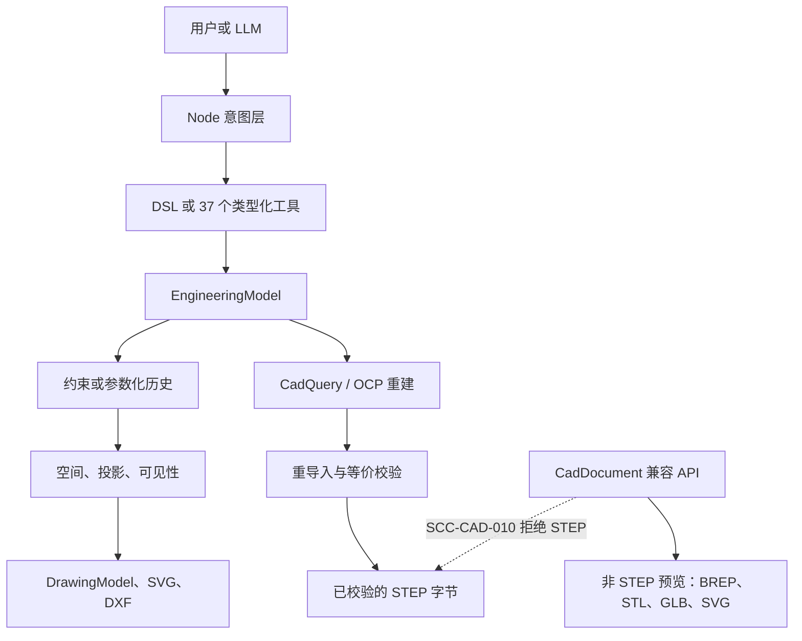

[English](README.md) | [简体中文](README.zh-CN.md)


# AICAD

**Semantic Constraint Compiler（语义约束编译器）**

从工程意图到可验证的 CAD。

  

AICAD 是一个面向可描述零件的 alpha CAD 编译器。自然语言只是提出工程模型的一种可选方式，不是几何内核。语言模型不直接写出实体、工程图或 STEP。这些产物来自确定性工程链：类型化模型、约束求解或特征历史重建、正交工程图，以及导出前经过重导入和等价校验的 STEP。

它不是通用商业 CAD 的替代品。支持的几何是有界的，不少操作会故意失败关闭。0.4.0-alpha.1 是公开 Alpha。下面的能力描述的是这棵源码树。某一行只有在 [docs/release/TEST_REPORT.md](docs/release/TEST_REPORT.md) 写明该命令已在这棵树上通过时，才能叫做“本快照已验证”。

## 为什么做 AICAD？

常见的文本生成 CAD，是让模型输出脚本或网格，再期待它就是那个零件。后续编辑对不上同一个孔、工程图对不上实体、或者拿到的 STEP 并不是被校验过的那一份时，这条路会断。

AICAD 把这些工作留在工程内核里。内核不知道你用的是哪一家模型。

| 主张 | 代码里实际是什么 |
| --- | --- |
| 可编辑的工程模型 | `crates/scc-engineering` 中的 `EngineeringModel` 是设计状态。项目文件保存元数据和这个模型，不保存一次性网格。 |
| 确定性几何管线 | v1 零件经 `scc-geometry` 进入空间、投影、可见性和工程图 crate。v2 历史按顺序经 CadQuery/OCP 重建。 |
| 结构化约束 | 求解器只接受封闭集合：Fixed、Datum、CenterOf、点距检查、Align、Parallel、Perpendicular、ArrayRelation、InstanceOf。其余失败关闭。 |
| 经过校验的制造导出 | 正式 STEP 会构建、重导入并比较。返回的字节就是通过检查的字节。 |
| 不支持的操作失败关闭 | 缺数据和域外几何返回稳定的 `SCC-*` 错误。管线不会拿一个看起来像的实体顶上。 |
| 与模型厂商无关的工程核 | 供应商代码在 Node 服务中（`ADR-020`）。Rust crate 不引用 LLM SDK。 |

## 看一个真实例子

本快照里可复现的零件是内置安装板：120 mm × 80 mm 矩形，厚 10 mm，四角孔。工作台按钮 **载入内置安装板** 加载的 DSL 与 [examples/mounting-plate.dsl](examples/mounting-plate.dsl) 相同。不需要 AI 供应商。

```text
工程意图或 DSL
  -> EngineeringModel
  -> 几何
  -> 前视 / 俯视 / 左视
  -> 经过校验的 STEP
```

先构建编译器，再跑两条不需要 CadQuery 的命令：

```bash
cargo build --locked --release -p scc-cli
./target/release/scc engineering dsl examples/mounting-plate.dsl > /tmp/mounting-plate.model.json
./target/release/scc engineering drawing-three-view /tmp/mounting-plate.model.json
```

正式 STEP 使用同一个模型，并走 CadQuery：

```bash
./target/release/scc engineering export-step /tmp/mounting-plate.model.json > /tmp/mounting-plate.step
```

当 `SCC_CAD_PYTHON` 无法导入 CadQuery 时，`export-step` 会失败关闭。Docker 镜像会设置这个变量。不要把这个模型交给 `POST /api/cad/build` 并期待得到 STEP。那条路由返回 `SCC-CAD-010`。

下面这张图是基线 `0568fac` 的祖先提交上，G7B 放样验收时录下的 Engineering Workbench 画面。它不是为 0.4.0-alpha.1 重新截取的，也不是安装板示例。它展示的是有界 Loft 能够表达的三截面放样夹具。


## 架构



两套权威分开。

- **EngineeringModel** 是正式零件。v1 是基体轮廓加上孔、阵列和槽。v2 是有序参数化历史；一旦出现这些特征，项目 schema 为 2。v2 不走遗留 Proposal 求解器。v2 的正式 STEP 以 `FormalManufacturingInput::ProjectV2` 进入，并在同一套重导入检查处结束。
- **CadDocument** 是用于预览和非 STEP 产物的兼容编辑器。`POST /api/cad/build` 以非 shell 方式运行 `python -m aicad_cad.worker`，并拒绝 STEP 产物。

兼容 CAD 端点不能绕过 STEP 校验。

## 功能

状态的含义：

- **本快照已验证**：测试报告记录该命令在这棵树上通过。
- **有限 / 实验**：源码实现了有界行为。要么几何域被故意收窄，要么本快照还没有重跑证明测试。
- **尚未支持**：操作会被拒绝，或模型里没有这项能力。

有界用例可以通过，能力仍然保持 **有限 / 实验**，因为几何域是故意收窄的。[docs/release/TEST_REPORT.md](docs/release/TEST_REPORT.md) 是本快照的证据。报告里没有的项不是通过。本树的门控 G7C Sweep 和 Loft 用例已通过，范围仍是功能表里的窄域。

| 能力 | 状态 | 本树中的边界 |
| --- | --- | --- |
| 草图 | 有限 / 实验 | v1 轮廓：矩形、圆、圆角矩形、多边形、单个闭合 Line/Arc 复合轮廓。v2 草图位于主平面或受支持的基准面。 |
| 拉伸 | 有限 / 实验 | v2 ADD/CUT，使用已有的范围类型。单一实体。 |
| 旋转 | 有限 / 实验 | 绕主轴或两点基准轴的完整或部分 ADD/CUT。 |
| 孔 / 阵列 | 有限 / 实验 | 通孔与盲孔、G6B 范围内的沉头孔，以及校验器允许的线性、圆周、四角和显式放置阵列。 |
| 圆角 / 倒角 | 有限 / 实验 | 语义解析能唯一命名的边上的常半径圆角和等距倒角。没有变半径圆角，也没有距离-角度倒角。 |
| 扫掠 | 有限 / 实验 | 开放的平面 Line/Arc 路径、C1 连接、固定副法线、等截面、ADD/CUT、单一实体。没有封闭、尖角、变截面、扭转或 Frenet 扫掠。本树的有界 G7A 用例通过。门控 G7C 用例在端盖内部孔和 0.25 mm 轮廓圆角上通过。与管端同直径的孔会失败关闭。 |
| 放样 | 有限 / 实验 | 2 到 32 个草图，各自一个外环，平面平行且同向，偏移单调，直纹且对齐，曲线顺序对应。没有光滑放样、内环或非平行截面。本树的有界 G7B 用例通过。门控 G7C 相邻截面倒角也通过。几何域仍是这一格写出的窄范围。 |
| 正交工程图 | 有限 / 实验 | 由投影和可见性模型得到的前视、俯视、左视。第一角或第三角是图纸放置方式。 |
| 剖视图 | 有限 / 实验 | 主平面 A-A 剖视只在 EngineeringModel v2 重建之后生成。本树的 G6A 通过。v1 模型（包括安装板）以 `SCC-DRW-024`（`SECTION_PARAMETRIC_REBUILD_REQUIRED`）失败关闭，不会编造剖视。不是任意剖切工具。 |
| STEP 导出 | 有限 / 实验 | 仅正式路径，须经过重导入和等价校验。v1 覆盖已封闭的制造轮廓集合。v2 使用同一检查器。 |
| Engineering Workbench | 有限 / 实验 | 唯一界面在 `/engineering.html`，默认中文，可切换英文。本树的 Playwright 在真实工作台上，用假 Provider 通过了 G3、G4、G5、G6B、G7A 和 G7B。G6A.2 和 G6A.3 失败。`browser-g6a.mjs` 没有运行。这不是 DeepSeek 测试。 |
| 自然语言 | 有限 / 实验 | 可选。新建必须回到 DSL。修改必须回到类型化工具。本快照没有把真实的 DeepSeek 或 Qwen 调用当作验收。 |
| G7C 生成面选择器 | 有限 / 实验 | 本树的门控 Sweep 和 Loft 用例通过：端盖、侧面、端盖内部的孔、被引用轮廓边上的圆角或倒角、编辑后重建、正式 STEP 重导入，以及缺失身份时失败关闭。与管端同直径的 Sweep 孔以 `TOPOLOGY_REFERENCE_STALE` 失败关闭。这不是每个生成面都有选择器。 |
| 装配、多实体、完整 NURBS | 尚未支持 | 会被拒绝，或模型中不存在。 |
| 完整 GD&T / PMI、标题栏、标准图框 | 尚未支持 | 尺寸公差有有界实现。图框和 PMI 没有。 |
| 螺纹、抽壳、通用自由曲面 | 尚未支持 | 没有螺纹特征，也没有通用抽壳。 |

## 快速开始

同一组命令的说明见 [docs/getting-started/quickstart.md](docs/getting-started/quickstart.md)。

### 环境

- 使用镜像时需要 Docker Engine。Compose 只把界面发布到 `127.0.0.1:4173`。
- 或者使用 Rust 1.96.0（`rust-toolchain.toml`）、Node.js 20 或更新版本，以及 npm。
- 正式 STEP 和 v2 的 OCP 重建需要带 `cadquery==2.8.0` 的 Python 3.12，或者使用会安装这个版本的 Docker 镜像。宿主机不需要 GPU。

### A. Docker

镜像构建会拉取 `rust:1.96.0-bookworm`、`python:3.12.11-slim-bookworm` 和 `node:24.18.1-bookworm-slim`，并安装 CadQuery。最终进程以 `node` 用户运行。生产镜像标签是 `aicad-scc-ui:0.4.0-alpha.1`。本机执行 `docker compose build ui` 失败：守护进程连 `registry-1.docker.io` 时 TLS 握手超时。镜像没有构建，也没有推送。下面的命令是文件契约。

```bash
docker compose up --build ui
```

打开 <http://127.0.0.1:4173>。`/` 会转到 Engineering Workbench。离线演示使用 **载入内置安装板**。三视图从图纸面板生成。STEP 使用工程导出动作，不要使用兼容 CAD 控件。

用 `Ctrl-C` 停止。填进 AI 设置的密钥只存在于进程内存中，替换容器后即消失。

### B. 从源码构建

```bash
cargo build --locked --release -p scc-cli
npm ci --prefix apps/scc-ui
SCC_BIN="$PWD/target/release/scc" npm start --prefix apps/scc-ui
```

除非用 `SCC_UI_HOST` 和 `SCC_UI_PORT` 覆盖，服务监听 `127.0.0.1:4173`。镜像内部的默认值是 `0.0.0.0` 和 `4173`，Compose 再把它绑回环回地址。

Windows PowerShell：

```powershell
cargo build --locked --release -p scc-cli
$env:SCC_BIN = Join-Path $PWD "target\release\scc.exe"
npm ci --prefix apps/scc-ui
npm start --prefix apps/scc-ui
```

### 常见错误

| 你看到的 | 含义 |
| --- | --- |
| `SCC-CAD-010`，并提到 STEP | 兼容 CAD 路由拒绝了 STEP。请使用 `/api/engineering/export/step` 或 `scc engineering export-step`。 |
| CadQuery 导入错误，或在实体出现前就出现制造后端错误 | 缺少 `SCC_CAD_PYTHON`，或没有安装指定版本。请使用 Docker，或使用安装了 `cadquery==2.8.0` 的虚拟环境。 |
| `scc --version` 不是 `scc 0.4.0-alpha.1` | 二进制与本快照不一致。请用 `--locked` 重新构建。`scripts/smoke-test.py` 期望这个字符串。 |
| 三视图面板出现 `SCC-*` 错误 | 模型超出工程图的域。别的路由返回 HTTP 200 不等于图纸成功。 |
| 意图调用没有工程结果 | 没有配置供应商。安装板夹具不需要供应商。 |
| Section A-A 返回 `SCC-DRW-024` | 模型不是 v2 参数化历史。同一 v1 零件的三视图和正式 STEP 仍可以成功。 |
| `curl` 访问 `127.0.0.1` 得到 502 | 本机 `HTTP_PROXY` 可能拦截了环回地址。服务本身可能是正常的。请使用 `curl --noproxy '*'`，或使用不走该代理的 Node `fetch`。 |

## 它如何工作

1. 人或者模型给出意图。
2. Node 层可以把新建请求变成 AICAD DSL，或把修改变成 `crates/scc-tools` 中 37 个类型化工具之一。模型不能返回 CadQuery 脚本。
3. Rust 内核把输入应用到 `EngineeringModel` 并校验。
4. v1 几何被求解。v2 几何按完整顺序重建。失败的重建不会被存成零件。
5. 工程图是派生结果，不是第二份可编辑实体。
6. STEP 只有在形状、单一实体、重导入和等价检查之后才会给出。工程图几何不是 STEP 的来源。

参数和特征历史才是可编辑记录。STEP 是这份记录经过检查的交付物。修改 STEP 文件并不是 AICAD 修改零件的方式。

## 技术栈

| 组件 | 职责 |
| --- | --- |
| Rust workspace，18 个 crate | 模型、约束、参数化历史、空间计算、投影、可见性、工程图、制造规格、CLI。 |
| Node.js 服务 `apps/scc-ui` | HTTP API、Workbench、意图供应商、仅存于进程内的密钥。 |
| CadQuery 2.8.0 | 用来构建和重导入实体的 Python API。不是 AICAD 自己的内核。 |
| OCP / Open CASCADE | CadQuery 背后的 B-rep 内核。不是 AICAD 自己的内核。 |
| Three.js 0.184.0 | 浏览器中的兼容预览。 |
| Docker Compose | 一个 UI 镜像，加上可选测试服务。历史上的测试标签 `g3-test` 和 `g4-test` 仍然是测试服务的名字。 |

## 当前限制

- 面向有界零件域的 alpha 软件，不是生产级 CAD 套件。
- 没有通用装配，也没有多实体零件。
- 没有完整的 NURBS 或自由曲面建模器。
- 没有完整的 GD&T 或 PMI，也没有标题栏或 GB/ISO/ASME 图框。
- 不是任意复杂零件生成器。选择器有歧义时，调用会失败。
- Sweep 和 Loft 只存在于功能表写出的域内。
- G7C 只覆盖上面的门控用例。吃掉扫掠端盖轮廓的孔会失败关闭，不会再做圆角。
- 商业 LLM 供应商是可选的，本快照没有验收它们。配置了密钥就可能产生用量；一次成功的对话补全不是一个有效实体。
- 这里没有验证第三方 CAD 文件导入，包括 FreeCAD 文档。
- AICAD 这个名字与无关产品冲突。本快照不是商标清算。
- 原创源码使用 Apache-2.0。第三方代码保留各自的许可证。Docker 镜像没有公开发布。见 [NOTICE](NOTICE)。

## 路线图

这些是方向，不是日期。历史上的阶段编号在 `docs/adr/` 和 `CHANGELOG.md`。

| 方向 | 现在 | 下一步 | 更远 |
| --- | --- | --- | --- |
| 参数化建模 | 有界的拉伸、旋转、孔、阵列、圆角、倒角、扫掠、放样 | 只在新的失败关闭测试伴随下放宽扫掠和放样 | 抽壳、螺纹、多实体 |
| 语义拓扑 | 解析结果唯一时的稳定引用。门控 G7C Sweep 和 Loft 用例已通过 | 只在重建仍能找到一条精确边时增加选择器 | 每个生成面都可选择 |
| 工程图 | 三视图、主平面剖视、一部分关联尺寸 | ADR 仍标为部分支持的尺寸种类 | 标题栏、标准图框、PMI |
| CAD 交换 | 经过校验的 STEP 导出 | 按格式逐个确认外部 STEP 和其他内核 | 可信的往返编辑 |
| LLM 意图 | DSL 和类型化工具，与供应商无关 | 针对具体供应商的验收测试，单独报告 | 不让模型直接发出内核脚本 |
| 工作台 | 一个工程界面，默认只在本机 | 更清楚的错误，更少的过期缓存意外 | 不做第二套产品界面 |
| 开源工程质量 | Apache-2.0 源码 Alpha | `main` 上的公开 CI、私下安全报告 | 可维护的正式版本 |

## 参与贡献

见 [CONTRIBUTING.md](CONTRIBUTING.md)、[CODE_OF_CONDUCT.md](CODE_OF_CONDUCT.md) 和 [SECURITY.md](SECURITY.md)。

提交 PR 前运行 Rust workspace 测试和 `npm test`。在说明里写清几何边界。被跳过的测试不是通过的测试。

## 许可证

AICAD / SCC 原创源码使用 Apache License 2.0。正文在 [LICENSE](LICENSE)。[NOTICE](NOTICE) 记录所有者的授权。[THIRD_PARTY_NOTICES.md](THIRD_PARTY_NOTICES.md) 列出其他许可证。

GitHub 账户 Peng-33 已于 2026-10-10 确认该授权，包括原创源码的商业使用、修改和再分发。没有贡献者协议在生效。第三方组件保留各自的许可证。随 CadQuery/OCP 安装带入的 Open CASCADE Technology 是带 Open CASCADE 例外的 LGPL-2.1；Apache-2.0 不能把它重新许可。这个 Alpha 不是稳定的 1.0，Docker 镜像也没有公开发布。
