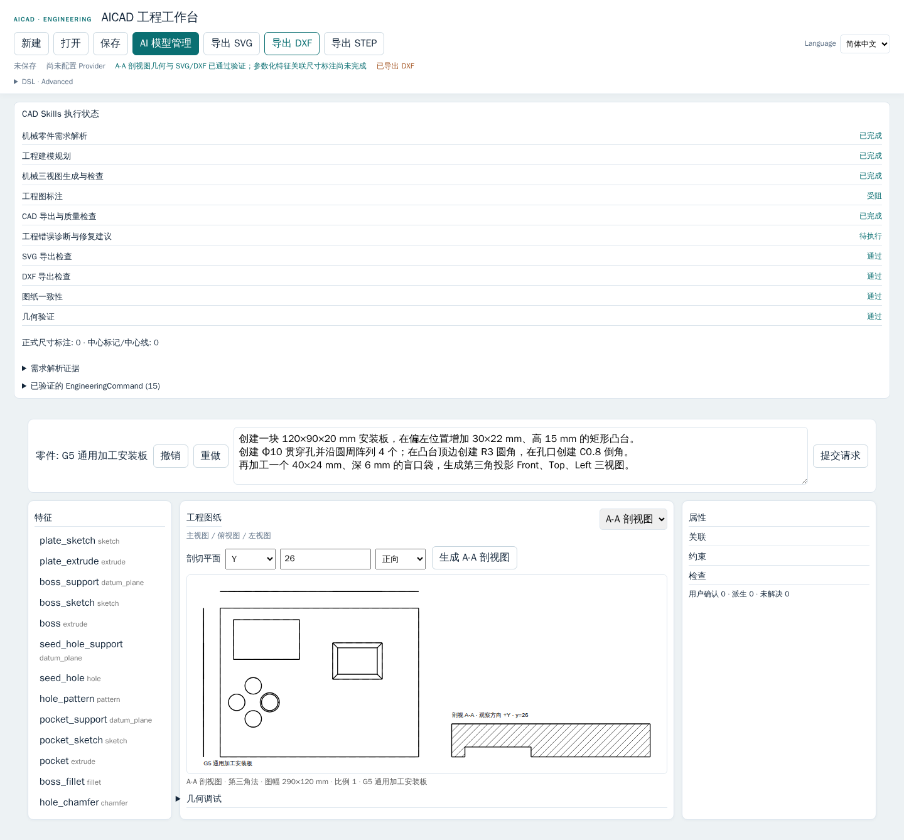

# Phase G6A — Engineering Drawing Acceptance Report

Date: 2026-09-26
Repository: `<repo>`
Starting HEAD: `29ffafadc35b1bbf33e138b7e56247666d137d3b`
Branch: `codex/aicad-pre-rollback-recovery`

## Result

```text
PHASE_G6A = PARTIAL
GENERAL_SECTION_VIEW = PASS_WITH_NOTES
SVG_DXF_SECTION_EXPORT = PASS
PARAMETRIC_FEATURE_LINKED_DIMENSIONS = PARTIAL / NOT_IMPLEMENTED
DRAWING_COMPLETENESS = PARTIAL
AICAD-COMPLEX-001 = BLOCKED (unchanged G5.1 C1 edge-set ambiguity)
REAL_DEEPSEEK = NOT_RUN
```

The implemented vertical slice derives a real principal-plane Section A-A from a validated EngineeringModel v2 rebuild, adds it to the same DrawingModel as Front/Top/Left, checks provenance and material hatching, then renders SVG and DXF. It does not complete the G6A linked-dimension matrix. UI and API reports intentionally retain `DRAWING_COMPLETENESS=PARTIAL` and `DRAWING_ANNOTATION=PARTIAL`; an exported section is not presented as a dimensioned manufacturing drawing.

## Capability audit

| Capability | G6A status | Evidence / boundary |
|---|---|---|
| Formal Front/Top/Left DrawingModel | IMPLEMENTED_VERIFIED | Existing projection/visibility and DrawingModel pipeline; retained. |
| Legacy engineering/geometry-linked annotations and dimensions | IMPLEMENTED_VERIFIED for legacy supported models | Existing Drawing dimension/source-map contracts and regression tests. They do not cover parametric-history machining features. |
| Center marks/centerlines | IMPLEMENTED_VERIFIED within existing supported drawing cases | Existing typed center geometry; no new parametric centerline coverage in this phase. |
| Principal-plane Section A-A | IMPLEMENTED_VERIFIED for the tested fixtures | Real OCP section from the same read-only rebuild, with X/Y/Z plane contract and signed view direction. |
| Section topology, holes and hatching | IMPLEMENTED_VERIFIED for tested loop cases | Closed loops; even-odd intervals hatch material only; no transient OCP topology index is persisted. |
| EngineeringModel v2 linked dimensions | MISSING / PARTIAL | No feature-linked dimension builder for parametric history. Dimensions and callouts are not inferred from model fields or AI text. |
| Drawing completeness for parametric features | PARTIAL | Section visibility and unsupported dimension status are explicitly reported. |
| SVG section geometry and view labels | IMPLEMENTED_VERIFIED | Actual browser download inspected for four view IDs, section label and section hatch. |
| DXF section geometry and units | IMPLEMENTED_VERIFIED | Actual browser download inspected for hatch entity layer and `$INSUNITS=4` millimetres. Dimensions continue to be line/arrow/text geometry, not native DIMENSION entities. |
| Drawing standard metadata / full standards conformance | MISSING / NOT_CLAIMED | No comprehensive ISO/ASME compliance claim. |

## Implemented path

```text
EngineeringModel v2
→ same ordered, validated parametric rebuild
→ real CadQuery/OCP solid section
→ closed sampled loops (0.01 mm chord tolerance)
→ one DrawingModel: Front / Top / Left / Section A-A
→ SVG and DXF from that DrawingModel
```

CLI: `scc engineering drawing-section FILE --axis x|y|z --offset-mm N --view-side positive|negative`
HTTP: `POST /api/engineering/drawing/section`

Section geometry is read-only and has a digest binding to the source EngineeringModel. The section UI does not create another model, change features, persist a B-Rep, or alter STEP authority. Empty intersections and invalid/open section results fail closed.

## Section matrix S1–S10

| Case | Result | Evidence / limitation |
|---|---|---|
| S1 Base body section | PASS | Browser Section A-A from the generic parametric body. |
| S2 Through-hole section | PASS | OCP test preserves outer boundary and inner hole as separate loops; repeat result deterministic. |
| S3 Blind-hole section | PASS | OCP section tests verify actual blind pocket floor and side-hole end from the rebuilt B-Rep. |
| S4 Blind-slot section | NOT_RUN | No G6A test explicitly sections a blind slot. |
| S5 Counterbore section | NOT_RUN | Counterbore construction is covered by prior OCP/manufacturing tests, but this phase did not prove its section rendering. |
| S6 Revolved body section | NOT_RUN | Generic revolve manufacturing remains covered by G4; a Section A-A of a revolved fixture was not run. |
| S7 Plane with no valid intersection | PASS | OCP worker rejects empty section with `SECTION_NO_INTERSECTION`; malformed plane also fails closed. |
| S8 Hole not filled by hatch | PASS | Rust hatch test proves a through-hole splits material hatch intervals; OCP section keeps inner loop. |
| S9 Determinism | PASS | Rust→OCP repeat section reported identical loops; browser produced one section result. |
| S10 Upstream geometry edit | PASS for section geometry | Rust→OCP integration changed a feature depth and verified refreshed section geometry. Linked annotation update is unsupported. |

Six CAD Skills remain registered; the Drawing Annotation, Orthographic Drawing, Export Validation, and Engineering Diagnostics skills were extended for section planning/status and stable Chinese diagnostics. No duplicate skill was added. The remaining two built-in skills were unchanged.

The browser acceptance used the existing isolated fake-provider fixture: a 120×90×20 mm plate, raised boss, four-hole pattern, blind pocket, fillet and chamfer. It generated Front/Top/Left and a Y=26 mm A-A section. The exact G6A fixture requested in the phase brief (140×100×20 plate, Ø20 through hole, blind pocket, side blind hole and counterbore) was **not** completed as one Drawing acceptance fixture; therefore generic fixture coverage is PARTIAL.

## Dimension matrix D1–D13

No D1–D13 item is claimed complete for EngineeringModel v2 parametric history. The existing three-view annotator deliberately does not synthesize manufacturing dimensions for this parametric footprint. This avoids treating undeclared or unobserved geometry as a formal dimension.

| Case | Result | Evidence / limitation |
|---|---|---|
| D1 Overall length | NOT_IMPLEMENTED | No linked linear dimension generated for parametric history. |
| D2 Overall width | NOT_IMPLEMENTED | Same limitation. |
| D3 Base thickness | NOT_IMPLEMENTED | Same limitation. |
| D4 Through-hole diameter | NOT_IMPLEMENTED | OCP geometry may contain a cylinder; this drawing path does not create a typed linked diameter annotation. |
| D5 Blind-hole depth | NOT_IMPLEMENTED | Section exposes geometry but no formal depth callout. |
| D6 Counterbore diameter/depth | NOT_IMPLEMENTED | No linked counterbore callout. |
| D7 Fillet radius | NOT_IMPLEMENTED | No linked radius dimension for parametric edge treatment. |
| D8 Dimension update after edit | NOT_RUN | Section geometry updates after a depth edit; dimension update cannot be tested without D1–D7 annotations. |
| D9 Suppressed feature handling | NOT_RUN | No feature-linked annotation exists to invalidate. |
| D10 Invalid FeatureReference failure | NOT_RUN | This phase did not add a parametric dimension-reference contract. |
| D11 Reject dimension on inapplicable view | NOT_RUN | This phase did not add parametric dimension-view applicability. |
| D12 SVG dimensions | NOT_RUN | No D1–D7 parametric dimensions are emitted to inspect. |
| D13 DXF dimensions | NOT_RUN | Same; DXF continues to emit supported drawing primitives, not native DIMENSION entities. |

## Drawing completeness and cross-representation limits

The actual DrawingModel/SVG shows the selected section outline and hatch. It does not formally annotate blind depths, counterbore values, pattern counts, fillet/chamfer values, or all overall dimensions for EngineeringModel v2. Those items remain unsupported/unobservable as manufacturing callouts even if a section silhouette exposes some of their geometry. No dimension value was copied from EngineeringModel into three independently claimed observations.

Oblique, stepped, and rotated sections; automatic industrial dimension placement; typed linked dimensions for parametric features; GD&T, datum symbols, surface roughness, fit lookup; and complete standards compliance remain deferred. Existing DXF dimensions are line/arrow/text representations under ADR-030, not native DIMENSION entities.

## Timing evidence

One browser-requested rebuild/drawing response (milliseconds; this is a single fixture observation, not a benchmark):

| Stage | Observed | Meaning / limit |
|---|---:|---|
| History lowering | 0.132779 | EngineeringModel v2 lowering to the rebuild request. |
| Body kernel rebuild | 1382.267628 | Total CadQuery/OCP worker rebuild for this fixture, including its ordered features. |
| Base/extrude/revolve operation subtotal | 62.934651 | Worker-reported base operation timings; excludes later boolean/treatment stages. |
| Topology resolution subtotal | 6.162299 | Worker-reported semantic selector resolution. |
| Spatial lowering | 0.003683 | Rebuild witness to SpatialModel. |
| Orthographic projection + visibility | 0.177803 | Combined existing projection/visibility stage. |
| Section geometry | 2.420901 | OCP section operation and closed-loop sampling. |
| Drawing integration | 0.200208 | Combined DrawingModel assembly, section material hatch/provenance and section validation. A finer section-projection/validation split is not currently exposed. |
| Annotation layout | NOT_RUN | No parametric linked dimension layout was executed; not reported as a measured zero-cost feature. |
| SVG export | 0.186301 | DrawingModel-to-SVG serialization. |
| DXF export | 0.134588 | DrawingModel-to-DXF serialization. |

## Regression evidence

| Verification | Result | Scope |
|---|---|---|
| `cargo fmt --all -- --check` | PASS | Workspace formatting. |
| `cargo check --workspace --all-targets` | PASS | Full Rust workspace/all targets. |
| `cargo test --workspace --all-targets` | PASS | Full Rust workspace: 1145 passed, 0 failed, 2 ignored. |
| `cargo clippy --workspace --all-targets -- -D warnings` | PASS | Full Rust workspace; strict check rerun after the exact section-frame validation change. |
| `npm test --prefix apps/scc-ui` | PASS | 178 tests: 157 passed, 21 environment-gated OCP integration skips. |
| CadQuery/OCP | PASS | 105 Python tests in isolated `aicad-scc-ui:g6a-test` image. |
| Rust→OCP / STEP / Project v1-related integration suite | PASS_WITH_NOTES | Full suite exit code 0 after final backend change. The preceding unfiltered run reported 34 tests: 28 passed, 6 environment-gated skips. Final-image G6A targeted section test: 1/1 passed; exact frame mismatch negative test passed. |
| `docker compose config --quiet` | PASS | Compose configuration. |
| `git diff --check` | PASS | Final source/doc whitespace check. |
| Playwright real browser with fake Provider | PASS_WITH_NOTES | Chinese Workbench; Engineering Intent; three views; real section endpoint; SVG and DXF downloads; no page or HTTP errors. Does not cover D1–D13 or the exact G6A machining fixture. |
| Real DeepSeek call | NOT_RUN | No user key read or real provider request made. |

Browser result:

```text
BROWSER_ACCEPTANCE=PASS (implemented section/export flow)
Provider=fake
Views=Front/Top/Left/Section A-A
Section loops=1
SVG bytes=23574
DXF bytes=11426
REAL_DEEPSEEK=NOT_RUN
```



Screenshot SHA-256: `8eb115ad4c78ab7463a2cb6e5da35dbc7bbaa8021e5d4d982e65f689915091dc` (1440×1338).

## Complex part

`AICAD-COMPLEX-001` was not used to drive the G6A implementation. Its previous G5.1 supported subset is not a full-part acceptance. Requirement C1, “the remaining designated base outline sharp edges C1,” still lacks a specified semantic edge set; therefore `FULL_COMPLEX_PART_SUPPORT=BLOCKED`. No edge set or dimension was guessed, and no complete-part STEP was created. See [G5.1 acceptance report](../phase-g5.1-manufacturing-closure/acceptance-report.md).

## Final scope statement

The Section A-A geometry/export slice is verified for the tested cases. G6A as a whole remains `PARTIAL` until typed parametric feature-linked dimensions, dimension update/suppression/reference checks, the requested full generic machining Drawing fixture, and additional section cases (blind slot, counterbore and revolve) are implemented and verified. No Sweep/Loft or other subsequent feature phase was started.
