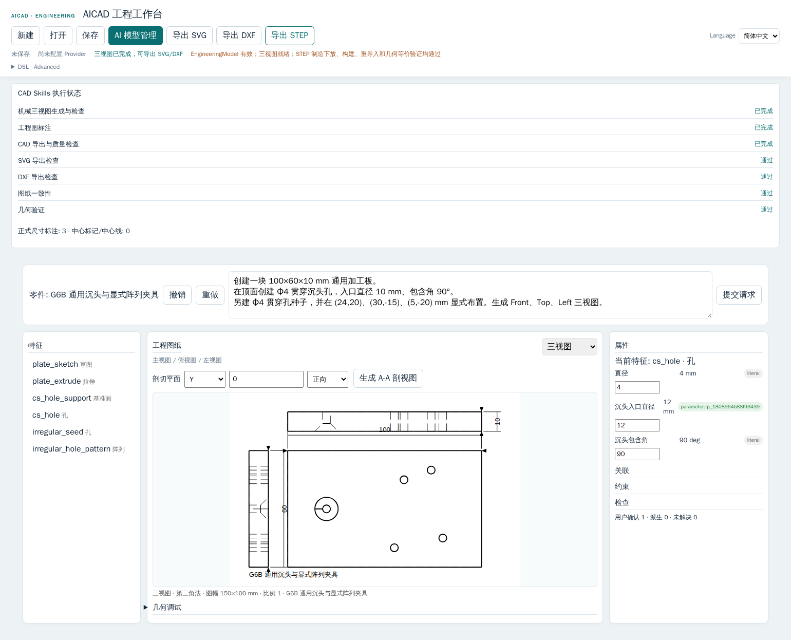

# Phase G6B — Acceptance Report

**Date:** 2026-09-27
**Project:** `<repo>`
**Starting branch/HEAD:** `codex/aicad-pre-rollback-recovery` / `4bbaf4c9474036a485c8e23b8743d7bb3d967369`
**Phase result:** `PASS_WITH_NOTES`
**ADR:** [ADR-074 — General Countersink and Explicit Placement Pattern](../../adr/adr-074-general-machining-features-countersink-explicit-placement-pattern.md)

## Scope and implementation summary

The starting working tree had no tracked changes. The pre-existing untracked `docs/testing/mmf204-real-user-acceptance/` was preserved and excluded from staging.

G6B reused the existing v2 Hole/Countersink model and Pattern feature. Countersink now lowers to a typed transient operation after the source bore, and CadQuery/OCP subtracts one analytic cone whose depth is derived from the mouth/bore diameters and included angle. ExplicitPlacementPattern stores one stable seed identity, a principal or DatumPlane reference frame, and ordered local U/V target positions. Seed instances remain derived during rebuild; they are not copied into the editable feature history.

Both capabilities use the same EngineeringModel v2 rebuild for Spatial/Drawing and canonical STEP. STEP still requires valid single-solid geometry, serialization, OCP re-import, geometric/material equivalence, and exact delivery of the validated bytes. No part-specific production builder or second STEP entry point was added.

## Acceptance status

| Gate | Status | Evidence / boundary |
|---|---|---|
| `COUNTERSINK_SCHEMA` | `PASS` | Existing typed Hole kind retained; mouth diameter and included angle are explicit. |
| `COUNTERSINK_GEOMETRY` | `PASS_WITH_NOTES` | Real OCP cone cuts pass all signed principal directions; tangent curved-barrel placement remains unclaimed after exceeding unchanged STEP tolerances in one exploratory fixture. |
| `COUNTERSINK_MULTI_AXIS` | `PASS` | `+Z`, `-Z`, `+X`, `-X`, `+Y`, `-Y`; analytic cone surface, axis frame, and expected volume verified. |
| `COUNTERSINK_PARAMETER_EDIT` | `PASS` | Typed mouth/angle slots; valid parameter edits rebuild, invalid edits fail atomically. Browser verified the mouth value changes from 10 to 12 mm while the original feature literal remains unchanged. |
| `COUNTERSINK_DRAWING` | `PASS_WITH_NOTES` | OCP-derived mouth geometry and A–A section geometry verified. `GEOMETRY_SUPPORTED = PASS`; standard Countersink callout is not supported: `ANNOTATION_SUPPORTED = PARTIAL`. |
| `COUNTERSINK_STEP` | `PASS` | Formal HTTP API, analytic cone dimensions/angle/axis, re-import, geometric equivalence, and delivered-byte evidence passed. |
| `EXPLICIT_PATTERN_SCHEMA` | `PASS` | Typed `explicit_placement` definition with seed Feature ID, reference plane, and ordered local U/V placements. |
| `EXPLICIT_PATTERN_HOLE` | `PASS` | Seed plus three nonuniform derived Hole positions visible in Drawing and re-imported STEP. |
| `EXPLICIT_PATTERN_EXTRUDE_CUT` | `PASS` | Seed plus three nonuniform CUT instances produce projected profiles and actual STEP floor faces. |
| `EXPLICIT_PATTERN_REBUILD` | `PASS` | Repeated rebuild is byte-stable; editing the seed regenerates every instance. Integration rejects missing/suppressed seeds; engineering validation tests reject non-finite and duplicate targets and unsupported planar-face frames; geometry no-intersection checks remain active. |
| `EXPLICIT_PATTERN_DRAWING` | `PASS` | Projected circles/segments derive from rebuilt geometry, not instance-count text. |
| `EXPLICIT_PATTERN_STEP` | `PASS` | Re-imported OCP cylinder/floor surfaces confirm instance positions and real cuts. |
| `GENERIC_COUNTERSINK_FIXTURE` | `PASS_WITH_NOTES` | Generic plate includes through/blind/top/bottom/side Countersinks, CircularPattern, and section evidence; the revolve fixture uses a planar end face. |
| `GENERIC_EXPLICIT_PATTERN_FIXTURE` | `PASS` | Generic irregular hole and Extrude CUT layouts use seed-plus-target semantics. |
| `SPATIAL_INTEGRATION` | `PASS` | Sampled B-spline edge evidence is bounded at 0.05 mm deviation and 512 samples per edge. |
| `PROJECTION_INTEGRATION` | `PASS` | OCP HLR curves restore analytically where possible and otherwise tessellate within 0.01 mm. |
| `VISIBILITY_INTEGRATION` | `PASS` | Visibility uses the generated OCP projection evidence. |
| `DRAWING_INTEGRATION` | `PASS_WITH_NOTES` | Three views, A–A sections, SVG and DXF reflect rebuilt geometry; standard Countersink angle/mouth callout remains partial. |
| `SVG_EXPORT` | `PASS` | G6B generic fixture SVG: 59,086 bytes; browser SVG download verified. |
| `DXF_EXPORT` | `PASS` | G6B generic fixture DXF: 42,723 bytes; browser DXF download verified. |
| `STEP_REIMPORT` | `PASS` | Formal HTTP artifact re-imported through OCP as one valid solid. |
| `GEOMETRIC_EQUIVALENCE` | `PASS` | Existing bounds, volume, area, center-of-mass, analytic geometry, and material witnesses passed; tolerances were not relaxed. |
| `SAME_VALIDATED_BYTES` | `PASS` | Browser downloaded 42,525 bytes; SHA-256 `52c30ba85d08de69553b1e27d6e4f20f1bf5ad59eff64c029c9050cc22815ea6`; browser and server validated-byte hashes/sizes matched. |
| `SIX_CAD_SKILLS_INTEGRATION` | `PASS` | All six existing Skills distinguish Countersink, Counterbore, and edge Chamfer and can plan explicit placements within capability bounds. |
| `WORKBENCH_INTEGRATION` | `PASS` | The single Engineering Workbench edits Countersink parameters and displays the rebuilt views; invalid edit rollback was verified. |
| `COMPLEX_PART_G6B_SUBSET` | `PASS_WITH_NOTES` | Existing general supported subset retains holes, patterns, multi-axis cuts, fillet/chamfer, 3 views, and formal STEP. No G6B-specific feature was silently omitted or added to the complex part. |
| `FULL_COMPLEX_PART_SUPPORT` | `BLOCKED` | Existing C1 target-edge set remains ambiguous; the full object is not represented by the tested subset. |
| `G1_G6A3_REGRESSION` | `PASS` | Rust workspace, Node, CadQuery/OCP, and shared v2 integration gates passed. The focused `scc-engineering` rerun after final validation-test coverage passed 223 unit, 2 compatibility, and 8 parametric-history tests. |
| `PROJECT_V1_REGRESSION` | `PASS` | Project v1 persistence/source-only STEP route regression passed in Node server tests. |
| `PROJECT_V2_REGRESSION` | `PASS` | Formal v2 API plus M1–M16 manufacturing matrix passed 16/16. |
| `FORMAL_STEP_REGRESSION` | `PASS` | G5 X2–X10 negative matrix passed 9/9 with legal follow-up requests 9/9; Project v2 M1–M16 passed 16/16. |
| `BROWSER_ACCEPTANCE` | `PASS` | Actual Chromium flow with isolated fake Provider, screenshot saved below. |
| `REAL_DEEPSEEK_TEST` | `NOT_RUN` | No real provider was called and no API key was accessed. |

## Geometry and drawing evidence

The CadQuery/OCP suite checked exact conical volume and analytic cone surfaces for all six signed principal directions. It rejects a mouth diameter no larger than the bore, an invalid angle, a missing source, and a cone that does not intersect the body. Engineering validation and geometry-build errors remain distinct.

The formal integration fixture contains a generic 100 × 60 × 10 mm plate, multiple through/blind Countersinks, bottom and side cases, a CircularPattern, an irregular ExplicitPlacementPattern of holes, and an ExplicitPlacementPattern of Extrude CUTs. Re-imported STEP evidence includes the expected cylinders/cones and each explicit hole/cut location. The side Countersink is verified with its non-Z axis. Seed edit changes all generated Hole circles deterministically; a suppressed seed returns `PATTERN_SEED_NOT_FOUND`.

The revolve fixture cuts a Countersink from the planar YZ end face of a generic revolved body. Its A–A section differs from the same body without the feature; STEP re-import verifies the analytic Ø8/Ø4, 90° cone and full-depth bore with independent material probes. The generic plate A–A output contains 32 section edges.

A test candidate placed the cone at a tangent curved-barrel location. It was not accepted: the existing STEP equivalence stage reported `volume_delta_mm3=7.53699933e-5` and `surface_area_delta_mm2=2.57869997e-5`, above the unchanged tolerances. The strict threshold was preserved, and the formal Revolve fixture uses a valid planar end face. Curved tangent placement remains an explicit limitation.

Countersink mouth diameter and angle are not represented as a standard drawing callout by the current annotation contract. The report and UI keep this visible instead of fabricating a textual manufacturing dimension.

## Browser acceptance

The actual Chromium test used an isolated fake Provider on an internal, no-port Docker network. It verified `/` enters the Engineering Workbench, Chinese multiline input is preserved, Countersink and ExplicitPlacementPattern appear in the EngineeringModel, three views render, a bad mouth edit rolls back without replacing the drawing, a valid typed edit changes the rebuilt volume from `59286.858467635` to `59204.129861091 mm³`, A–A section generation succeeds, SVG/DXF downloads work, and the downloaded STEP hash/size match the server’s validated bytes.

- Screenshot: [aicad-g6b-engineering-workbench.png](aicad-g6b-engineering-workbench.png)
- Screenshot SHA-256: `4c5df45bbae4f1b4ca34de63f4ee2441c2ac38aa56b63ea962073bcd7d45784c`
- Browser STEP: 42,525 bytes; SHA-256 `52c30ba85d08de69553b1e27d6e4f20f1bf5ad59eff64c029c9050cc22815ea6`
- Real Provider: `NOT_RUN`

## Verification results

| Command / suite | Result |
|---|---|
| `cargo fmt --all -- --check` | PASS |
| `cargo check --workspace --all-targets` | PASS |
| `cargo test --workspace --all-targets` | PASS |
| `cargo clippy --workspace --all-targets -- -D warnings` | PASS |
| `npm test --prefix apps/scc-ui` | PASS — 184 total; 162 passed, 0 failed, 22 environment-gated skipped |
| CadQuery/OCP Python suite | PASS — 110 tests |
| Rust→OCP / formal STEP integration | PASS — 15/15 tests |
| HTTP X2–X10 with legal follow-ups | PASS — 9/9 failures and 9/9 legal follow-ups |
| Manufacturing M1–M16 | PASS — 16/16 |
| Chromium / Playwright G6B | PASS — fake Provider, actual user flow and screenshot |
| `docker compose config --quiet` | PASS |
| `git diff --check` | PASS |

The G6B generic plate rebuild (25 ordered boolean operations, including countersink and explicit placements) reported `total_rebuild_ms=1998.883`, `kernel_rebuild_ms=1998.135`, `three_view_generation_ms=1.184`, SVG export `0.460 ms`, and DXF export `0.380 ms`. Countersink and array instances remain sequential boolean operations; no validation stage was disabled.

## Limits and deferred work

- Standard Countersink mouth/angle callout is not supported; geometry remains present and the diagnostic reports annotation limitation.
- Tangent Countersink cuts on curved barrel surfaces need a separate robust STEP-equivalence investigation.
- Explicit placements support local-plane target positions for Hole and Extrude CUT; arbitrary 3D orientation and Extrude ADD patterns are unsupported and fail closed.
- `AICAD-COMPLEX-001` full support remains blocked by the unresolved C1 edge-set ambiguity. G6B does not add Sweep/Loft or a complex-part-specific builder.
- Real DeepSeek was not called.

## Git delivery

- Branch: `codex/aicad-pre-rollback-recovery`
- Starting HEAD: `4bbaf4c9474036a485c8e23b8743d7bb3d967369`
- Final local commit: see task delivery summary.
- Push: `NO`
- Pre-existing `docs/testing/mmf204-real-user-acceptance/` remains untouched and unstaged.
