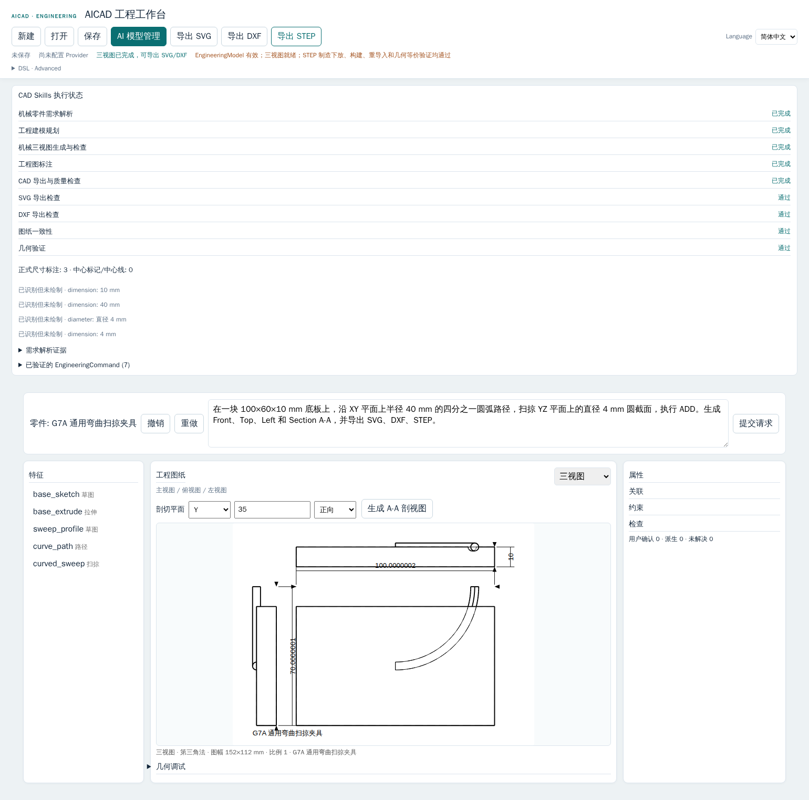

# Phase G7A — Parametric Sweep Acceptance Report

- Date: 2026-09-27
- Baseline HEAD: `59c1ce2cc92311437083049a91dee65270e05bbe`
- Branch: `codex/aicad-pre-rollback-recovery`
- Overall: `PASS_WITH_NOTES`
- Scope: generic planar fixed-section Sweep through EngineeringModel v2, OCP, Drawing, section output and the canonical STEP route.

## Gate Summary

| Gate | Result | Evidence / boundary |
|---|---|---|
| `GENERAL_PATH_MODEL` | PASS | Path is an ordered EngineeringModel v2 feature with stable segment IDs and principal/DatumPlane support. |
| `PATH_VALIDATION` | PASS | Empty, closed, degenerate, discontinuous and self-intersecting paths fail closed; finite radii, declared IDs, support and C1 joins are checked. |
| `SWEEP_PROFILE_ORIENTATION` | PASS | Profile anchor, directed start tangent and fixed-binormal frame are explicit and validated. |
| `SWEEP_ADD` | PASS | Real OCP single-solid Sweep ADD; first body and fused addition covered. |
| `SWEEP_CUT` | PASS | Real OCP boolean CUT; actual volume reduction, no-hit and full-body failure cases covered. |
| `CURVED_PATH_SWEEP` | PASS | Circular and composite Line/Arc paths change actual B-Rep; re-import retains analytic torus radii. |
| `MIXED_FEATURE_HISTORY` | PASS | `Extrude ADD → Sweep ADD → Hole → Fillet` and `Revolve ADD → Sweep CUT`. |
| `DETERMINISTIC_REBUILD` | PASS | Repeated geometry evidence matches; Path/profile edits rebuild from EngineeringModel. |
| `SUPPRESSION_MODIFICATION` | PASS | Sweep suppression removes its active operation; restore reproduces the prior spatial summary. |
| `SEMANTIC_TOPOLOGY_INTEGRATION` | PARTIAL | Existing stable provenance is reused; no raw OCP face/edge ordinal is persisted. A stable selector for every Sweep-generated face/edge is not promised. |
| `SPATIAL_INTEGRATION` | PASS | Verified OCP material evidence is returned for both fixtures. |
| `PROJECTION_INTEGRATION` | PASS | Existing orthographic projection consumes the rebuilt Sweep body. |
| `VISIBILITY_INTEGRATION` | PASS | Front/Top/Left pass through the existing Visibility pipeline. |
| `DRAWING_INTEGRATION` | PASS | DrawingModel, SVG and DXF contain the actual derived views; no feature-specific outline code. |
| `FRONT_VIEW` / `TOP_VIEW` / `LEFT_VIEW` | PASS | All three view records and exported SVG view IDs are asserted. |
| `SECTION_VIEW` | PASS | ADD browser fixture produces A-A; CUT fixture produces a four-view section drawing with 5 section edges and at least 2 boundary loops. SVG hatch and DXF hatch are asserted. |
| `SVG_EXPORT` / `DXF_EXPORT` | PASS | Browser downloads both; CUT fixture section SVG/DXF are also checked. |
| `FORMAL_MANUFACTURING` | PASS | Both generic fixtures use the current EngineeringModel v2 → CLI → CadQuery/OCP canonical STEP route. |
| `STEP_REIMPORT` | PASS | Independent STEP observer imports valid single solids for ADD and CUT. |
| `GEOMETRIC_EQUIVALENCE` | PASS | Canonical delivery passes existing strict equivalence. Drawing volume and independent STEP-reimport volume match within `1e-5 mm³` for both fixtures; analytic sweep radii are checked. |
| `SAME_VALIDATED_BYTES` | PASS | Browser download bytes exactly equal the corresponding successful HTTP response body; response SHA-256 and size headers match those bytes. Invalid requests return no artifact or success headers. |
| `GENERIC_SWEEP_ADD_FIXTURE` | PASS | Plate plus quarter-arc R40 path and circular Ø4 section; STEP re-import reports torus major radius 40 mm and minor radius 2 mm. |
| `GENERIC_SWEEP_CUT_FIXTURE` | PASS | Revolve body plus quarter-arc R6 path and circular Ø2 section; STEP re-import retains one valid solid and volume `14107.558127950551 mm³`. |
| `SWEEP_TEST_MATRIX` | PASS | S1–S18: 18/18 passed with real OCP geometry or explicit rebuild evidence. |
| `SIX_CAD_SKILLS_INTEGRATION` | PASS | Existing six Skills were updated; tool registry and manifest contain 35 tools including `create_path` and `create_sweep`; no Skill was added. |
| `WORKBENCH_INTEGRATION` | PASS | The sole Workbench and formal Engineering Intent create the v2 Path/Sweep features. |
| `G1_G6B_REGRESSION` | PASS | Full isolated Rust→OCP regression: 36/36 tests passed, including G1B–G6B. CadQuery/OCP Python suite: 114/114 passed. |
| `PROJECT_V1_REGRESSION` | PASS | Existing Project v1 CLI/formal STEP tests passed in the 36-test integration run. |
| `FORMAL_STEP_REGRESSION` | PASS | M1–M16: 16/16; X2–X10 HTTP negative cases: 9/9 with 9/9 legal follow-ups; Project v2 and G7A STEP tests passed. |
| `BROWSER_ACCEPTANCE` | PASS | Isolated Chromium + fake Provider; `/` reached the Engineering Workbench, `zh-CN`, no legacy proposal editor, three views, A-A, SVG/DXF/STEP downloads and invalid-request failure closure. Screenshot is saved below. |
| `REAL_DEEPSEEK_TEST` | NOT_RUN | No real Provider or API key was read or used. |

## S1–S18 Matrix

| Case | Real evidence | Result |
|---|---|---|
| S1 Circle + straight Path → ADD | OCP solid count 1; volume is `π × 1² × 10 mm³`. | PASS |
| S2 Circle + quarter-arc Path → ADD | OCP torus surface; volume matches analytic centerline length. | PASS |
| S3 Rectangle + arc Path → ADD | 2×4 mm section; volume matches area × arc length and includes analytic cylindrical faces. | PASS |
| S4 Composite Line/Arc → ADD | C1 joined open path creates one solid; volume exceeds the arc-only result by the line segment. | PASS |
| S5 Sweep CUT through body | Arc CUT on a 40×40×20 mm body lowers measured material volume; section exposes internal boundaries. | PASS |
| S6 Sweep + Extrude history | Plate Extrude → curved Sweep ADD → Hole → Fillet is present in active OCP feature evidence. | PASS |
| S7 Sweep + Revolve history | Revolve ADD → curved Sweep CUT is one valid material body and passes formal STEP. | PASS |
| S8 Invalid open profile | Rejected with `OPEN_PROFILE`. | PASS |
| S9 Discontinuous Path | Rejected with `PATH_DISCONTINUOUS`. | PASS |
| S10 Degenerate Path | Rejected with `PATH_DEGENERATE`. | PASS |
| S11 Invalid profile frame | Rejected with `SWEEP_PROFILE_ORIENTATION_INVALID`. | PASS |
| S12 Self-intersecting Path/Sweep guard | Crossing Path rejected with `PATH_SELF_INTERSECTION`; OCP result also requires a valid single-solid tool. | PASS |
| S13 Detached ADD | Rejected with `DETACHED_ADD`. | PASS |
| S14 CUT without intersection | Rejected with `SWEEP_CUT_NO_INTERSECTION`. | PASS |
| S15 Path modification | Radius/endpoints edit changes rebuilt bounds and Drawing evidence. | PASS |
| S16 Profile modification | Increasing the section radius increases actual rebuilt volume. | PASS |
| S17 Suppress/restore | Suppression removes the Sweep operation; restoring reproduces the original spatial summary. | PASS |
| S18 Deterministic rebuild | Repeated B-Rep bounds, volume and edge evidence match. | PASS |

## Generic Fixture Evidence

**Fixture A — curved additive Sweep.** The browser fake Provider creates a 100×60×10 mm plate, an XY quarter-circle Path of radius 40 mm, and a YZ circle profile of diameter 4 mm. Engineering Intent produces `Path` and `Sweep ADD` in EngineeringModel v2. Spatial/Projection/Visibility produce Front/Top/Left; A-A section generation reports actual section geometry. SVG, DXF and formal STEP download successfully. The downloaded STEP is exactly the response body validated by the server. The formal CLI fixture additionally combines `Extrude ADD → Sweep ADD → Hole → Fillet`; OCP re-import preserves the R40/R2 torus surface and one valid solid. The final full integration run emitted 52,037 STEP bytes with a per-export SHA-256 recorded as `d98c771c8be0f71b7b8293e3577a1a2d21205c86af7e6bccded92bbf166d7043`.

**Fixture B — curved subtractive Sweep.** A full Revolve body receives a circular section of radius 1 mm along a quarter-arc Path of radius 6 mm. The rebuilt body loses material. The A-A section at Y=3 mm produces 5 section edges, at least 2 boundary loops, SVG hatch and DXF hatch. Formal STEP delivery is 11,307 bytes; re-import produces one valid solid with volume `14107.558127950551 mm³`, within `1e-5 mm³` of Drawing’s `14107.558127951 mm³`. The STEP analytic surface retains major radius 6 mm and minor radius 1 mm. The final full integration run’s SHA-256 was `fcc4f7ebd16debc9f831db282eecbf2b7f9d6c1b45b1b66f7ee2b91d18ddb943`.

STEP metadata can vary across distinct export invocations. Hash equality is asserted between the exact response and downloaded artifact within one browser transaction; unrelated independent serializations are not treated as the same byte stream.

## Browser Evidence

Screenshot: [aicad-g7a-sweep-workbench.png](./aicad-g7a-sweep-workbench.png)

SHA-256: `00f7ec1a66d1053a7d3b357d67ca7be769a6b825a64cc7b57389cc909f9d74ad`

Final Chromium result: `BROWSER_G7A=PASS; provider=fake; locale=zh-CN; Path=quarter-arc-R40; Sweep=ADD; views=Front/Top/Left; section=PASS; SVG_BYTES=27683; DXF_BYTES=23275; STEP_BYTES=44253; STEP_SHA256=f01e935ccdd377ca7802874d9f19bf585fcf5ebf00ceb539a3d5ddcc56567b3a; invalid-sweep-no-artifact=PASS; REAL_PROVIDER=NOT_RUN`.

The `/` request redirects to `/engineering.html`, which is the same Engineering Workbench. The browser confirmed Chinese locale, retained multiline natural-language input, the v2 Path/Sweep history, no retired proposal editor, actual section geometry, and exact STEP response/download byte equality. Invalid disconnected Path returns HTTP 422 with `PATH_DISCONTINUOUS`, without SHA/download headers or a partial artifact.

## Regression Results

- `cargo fmt --all -- --check` — PASS
- `cargo check --workspace --all-targets` — PASS
- `cargo test --workspace --all-targets` — PASS
- `cargo clippy --workspace --all-targets -- -D warnings` — PASS
- `npm test --prefix apps/scc-ui` — PASS; 187 tests, 164 passed, 0 failed, 23 skipped by the existing test configuration
- Isolated CadQuery/OCP `python -m unittest discover -s apps/scc-ui/cad/tests -v` — PASS; 114 tests
- Isolated Rust→CadQuery/OCP/STEP/Intent regression — PASS; 36 tests in 187.4 s, including G1B–G6B, Project v1/v2, M1–M16 and X2–X10
- Updated focused G7A Rust→OCP test — PASS; 1 test, including CUT Section A-A/SVG/DXF, formal STEP re-import, analytic radii and Drawing/re-import volume checks
- Chromium fake-provider acceptance — PASS; see exact result and screenshot above
- `docker compose config --quiet` — PASS
- `git diff --check` — PASS

A fresh `aicad-scc-ui:g7a-test` image build was attempted but could not download the pinned `rustfmt` component from `static.rust-lang.org` before the network timeout. The authorized existing G6B CadQuery/OCP and Playwright images were reused with final source mounted read-only and the final Debian-compatible CLI binary mounted read-only. Test containers used no external network or published host ports; the browser test used only an internal Docker network, which was removed after completion.

## Supported Bounds and Known Limitations

- G7A supports open planar paths containing analytic Lines and Arcs with C1 joins only. Closed Paths, sharp corners, arbitrary 3D paths, variable sections, scaling, user twist, Frenet transport, Loft, NURBS/freeform and multi-body manufacturing are not implemented; unsupported inputs fail closed.
- Geometry support does not imply stable selectors for all Sweep-generated faces/edges. That topology-reference capability is `PARTIAL` pending generic stable surface/edge qualifiers.
- Existing G6B limitations remain independent: Countersink standard annotation; tangent curved-barrel STEP equivalence; arbitrary 3D ExplicitPlacement; Extrude ADD Pattern; Fillet-radius annotation; generic spacing/blind-depth annotation; complex-workpiece C1 target-edge ambiguity.
- No real DeepSeek request was made. No API key was read, emitted or modified.
- A successful model response alone is not treated as Drawing or STEP completion; the tests require derived views, actual section geometry and canonical STEP stages.
